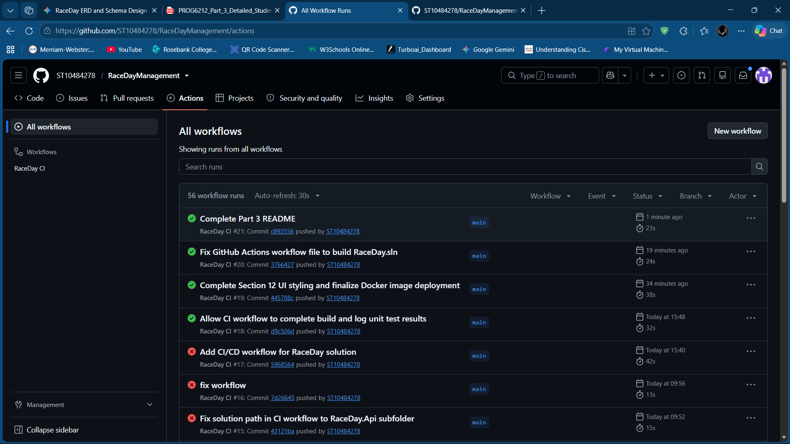

# RaceDayManagement
## 🏃 About RaceDay

**RaceDay** is a full-stack, web-based event management platform built specifically for the South African road running, walking, and cycling community. From iconic events like the Comrades Marathon, Cape Town Cycle Tour, and Soweto Marathon to local weekend park runs, RaceDay modernizes event operations by replacing traditional paper-based registrations and fragmented communications with a centralized, cloud-aware solution.

The platform provides an API-driven ecosystem that allows event organizers to create and manage events, categories, and participant results seamlessly, while giving participants a hub to browse events, register, view real-time route/weather details, and track their personal race performance history.

---

## 👥 User Roles & Responsibilities

RaceDay enforces Role-Based Access Control (RBAC) supporting two core system roles:

### 1. 📋 Event Organiser
Organisers are responsible for managing event operations, logistics, and race performance tracking.

* **Create, Edit, and Delete Events:** Set up race details including titles, descriptions, dates, and locations.
* **Manage Categories:** Define event sub-divisions (e.g., 42.2km Full Marathon, 21.1km Half Marathon, 10km Fun Run) with start locations, distances, and entry fees.
* **View Enrolments:** Access real-time participant registration lists and bib number assignments for managed events.
* **Capture Race Results:** Input and publish participant finish times, overall/category rankings, and completion statuses (`Finished`, `DNF`, `DNS`).

### 2. 🏃 Participant
Participants represent the athletes and runners using the platform to register for events and track their athletic progress.

* **Account Management:** Register a new user account and authenticate securely into the platform.
* **Browse Events & Categories:** Search and explore upcoming road running, walking, and cycling events.
* **Event Entry:** Register for specific event categories and receive unique race bib numbers.
* **Personal Dashboard:** View active event enrolments, prepare using route/weather information, and access historic race performance metrics over time.

## Part 2
Part 2 delivers a fully functional, RESTful Web API backend built with ASP.NET Core and Entity Framework Core. It implements session-like header-based Role-Based Access Control (RBAC), database state management with SQL Server, input validation, comprehensive unit/integration testing with xUnit, OpenAPI documentation via Scalar, and an automated continuous integration pipeline using GitHub Actions.

### Technologies Used
* **Framework:** ASP.NET Core Web API (.NET 9)
* **ORM & Database:** Entity Framework Core 9 with SQL Server
* **Authentication:** Password Hashing (BCrypt.NET) & Session Identity Headers (`X-User-Role`, `X-User-Id`)
* **Testing:** xUnit & `Microsoft.AspNetCore.Mvc.Testing`
* **Documentation:** Scalar OpenAPI UI
### GitHub Actions Screenshot

* **CI/CD:** GitHub Actions

## Part 3 - MVC Web Application
- Implemented role-aware MVC web application with Bootstrap component styling.
- Containerized `RaceDay.Mvc` using Docker.
- Managed cross-boundary container-to-host API communication.
- Applied reusable status CSS badges (`.status-confirmed`, `.status-pending`, `.status-cancelled`).
- Built user-friendly error handling in `AuthController.cs` to map API failures to `ModelState` and `TempData` alerts instead of raw exception stack traces.

## Prerequisites
- [.NET 8.0 SDK](https://dotnet.microsoft.com/download/dotnet/8.0)
- [Docker Desktop](https://www.docker.com/products/docker-desktop/)
- [SQL Server & SSMS](https://www.microsoft.com/sql-server/)
- [Git](https://git-scm.com/)

## Database Setup
1. Open SQL Server Management Studio (SSMS) and connect to your local database instance.
2. Run the SQL migration scripts in the `/Database` folder to create tables and seed default roles.
3. Configure your local connection string in `RaceDay.Api/appsettings.json`:
   ```json
   "ConnectionStrings": {
     "DefaultConnection": "Server=localhost;Database=RaceDayDb;Trusted_Connection=True;TrustServerCertificate=True;"
   }
## 🏗️ Solution Architecture & Structure

The repository is organized into a modular solution containing the backend REST API, shared contracts, automated test suites, and containerized MVC web frontend:

```text
RaceDayManagement/
├── .github/
│   └── workflows/
│       └── ci.yml               # GitHub Actions CI/CD Pipeline
├── docs/
│   └── github-actions-green-build.png
├── RaceDay.Api/                 # ASP.NET Core Web API (Controllers, Data Context, Database Services)
├── RaceDay.Contracts/           # Shared DTOs and Data Transfer Objects (Dtos.cs)
├── RaceDay.Mvc/                 # ASP.NET Core MVC Frontend (Controllers, Razor Views, Dockerfile)
└── RaceDay.Api.Tests/           # Automated Integration and Unit Tests (xUnit)